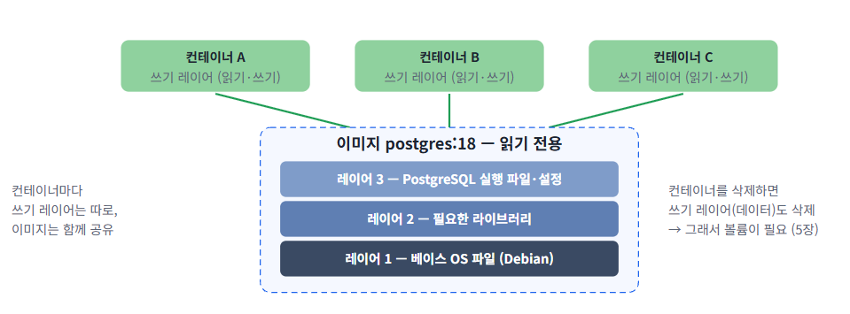

구분: 배운 내용(복습)
## 목차
### 1. 배운 내용 : Docker(ubuntu, webserver, mysql, postgres)
### 2. 문제 : 없음
### 3. 새롭게 알게 된 것 : 없음   
  
<br>
<br>

##  1. 배운 내용 
### 1. Dock 기초 
* image (이미지)
  * 컨테이너를 만들기 위한 읽기 전용 "템플릿"
  * image는 official 마크가 새겨진 것들만 사용 할 것. 
  * (예) 닌텐도 칩 (칩을 바꿔 끼우면 다른 게임이 실행되는 개념)
* container (컨테이너)
  * 컨테이너는 이미지를 실행 한 것. 
  * (예)닌텐도 칩을 꽂아서 게임을 실행 
  


<Docker Desktop 설치>

터미널에서 아래 코드 실행 
```
wsl --update
wsl --install 
```

<설치 확인>

터미널 open
```
docker --version 
docker compose --version 
docker info
```

<첫 터미널 실행 : Hello-world>

전체 실행 코드 
```
docker pull hello-world   # 설치
docker run hello-world    # 컨테이너 실행 
docker ps   # 실행 중인 컨테이너 목록 (아무것도 없음)
docker ps -a   # 실행 멈춤(즉, 생성된 모든 컨테이너 조회) 컨테이너 목록 (hello-world 있음) 
docker image ls   # 이미지 목록 (hello-world 있음)
docker rmi hello-world   # 이미지 삭제 
dockke image ls   # 삭제 확인 
docker rm hello-world -f   # 컨테이너 삭제 
docker ps -a # 삭제 확인 (아무것도 없음)
```


### 2. ubuntu


### 3. web server 


### 4. Mysql


### 5. postgres

